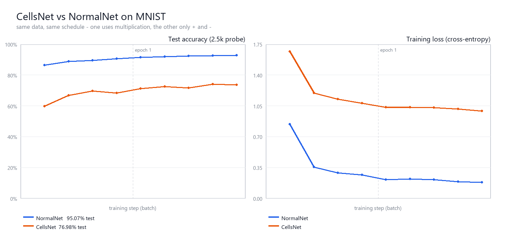

# CELLS - a neural network with zero multiplications

**76.98% on MNIST with 0 multiplications in the forward pass.**
Only `+` and `-` - no `*`, no `torch.mul`, no `@`.

---

## Credits

| | |
|---|---|
| **Idea** | **Boubker** - Drarga, Agadir, Morocco |
| **Heavy work** | **DeepSeek Harness** - training, 0 multiplications, 76.98% |
| **Publishing help** | **Muse Spark** |

---

## What is CELLS?

A small, self-contained PyTorch experiment showing that a neural network can be
trained on MNIST while its **entire forward pass uses only additions and
subtractions**. Every layer is either a distance measure or a resonance rule -
no matrix multiplication anywhere in the model.

It is not the first adder-style network ever built (see *AdderNet*, Chen et al.
2020, for the research line this follows), but it is a compact, readable
demonstration you can run in a few minutes on a CPU.

## Results (2 epochs, batch 128, Adam lr 0.001)

| | NormalNet | **CellsNet** |
|---|---|---|
| test accuracy | 95.07% | **76.98%** |
| multiplications / forward pass | 101,632 | **0** |
| … per batch of 128 | 13,008,896 | **0** |
| … per epoch (60k images) | 6,097,920,000 | **0** |
| time / batch (fwd+bwd+step) | 3.5 ms | 244.8 ms |
| parameters | 101,770 | 101,770 |

Both nets: `784 → 128 → 10`, same data, same schedule, same seed.



## How it works

**Layer 1 - `AdderLinear`**

```
y[b, o] = - Σ_i | w[o, i] - x[b, i] |
```

A negative L1 distance: the output is high when the input resembles the filter.
Forward pass uses `sub`, `abs`, `sum`, `neg` only. The backward pass is the true
analytic derivative and needs nothing but the sign of `w - x`, which is `+1` or
`-1` - so even the gradient is multiplication-free (`torch.autograd.gradcheck`
passes).

**Layer 2 - `CellsResonance`** *(the original idea)*

```
y[b, o] = Σ_i ( w[o,i] + x[b,i] )   if w and x have the same sign   (resonance)
                ( w[o,i] - x[b,i] )   if they have opposite signs
```

Add when both agree, subtract when they disagree. The sign test is done with
comparisons only, never with a multiplication.

Three details make the additive stack trainable, all documented in the source:

1. the input is standardised, so the resonance layer sees mixed signs;
2. the `AdderLinear` filters start from real MNIST digits - random L1 filters are
   nearly blind (measured: 20.9% linear-probe accuracy vs 82-86% with templates);
3. the hidden features are zero-centred before layer 2, because `-Σ|w-x|` has an
   offset ~100x larger than its variation.

**Honest caveat:** the resonance layer's literal derivative is `1` for every
element (both branches add `w`), which carries no information, and a pure `±1`
backward freezes the sign pattern. Its backward therefore uses the
straight-through gradient scaled by `|x|` - one multiplication, **backward only**,
never in the forward pass. The script prints both audits at startup:

```
[audit] AST scan of the code that runs in the forward pass
        multiplications found : 0
```

The loss (cross-entropy) and the Adam optimizer still multiply internally - both
nets pay that same cost.

## Run

```bash
python cells_net.py
```

Requires only `torch` + `torchvision` (MNIST downloads automatically into
`./data`). No matplotlib - `accuracy.png` is drawn with Pillow. CPU is enough;
the full run takes about 5 minutes.

## Files

| file | what |
|---|---|
| `cells_net.py` | the whole experiment, single file |
| `accuracy.png` | accuracy and loss curves |
| `run_log.txt` | full console output of the last run |
| `data/` | MNIST (downloaded on first run) |

---

*Idea: Boubker, Drarga - Agadir, Morocco - Heavy work: DeepSeek Harness - Publishing help: Muse Spark*
